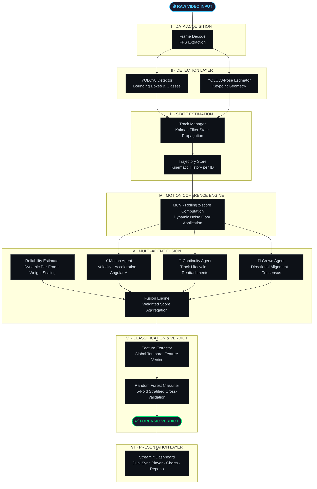
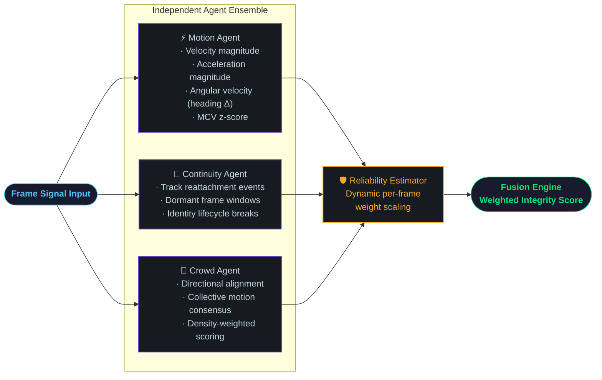
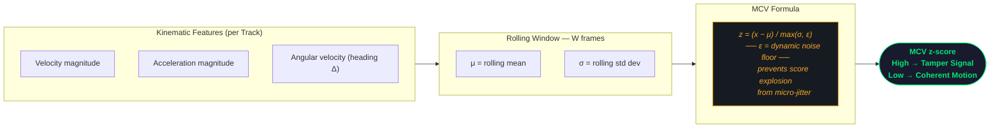
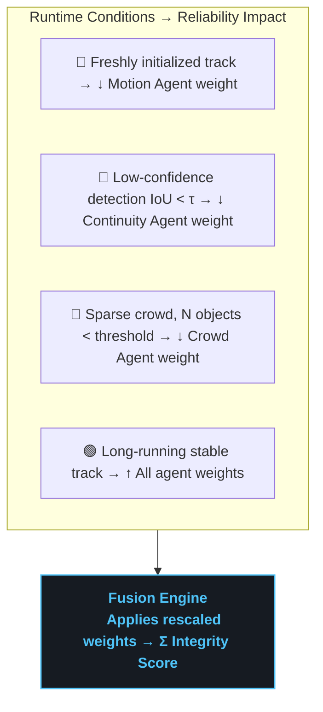
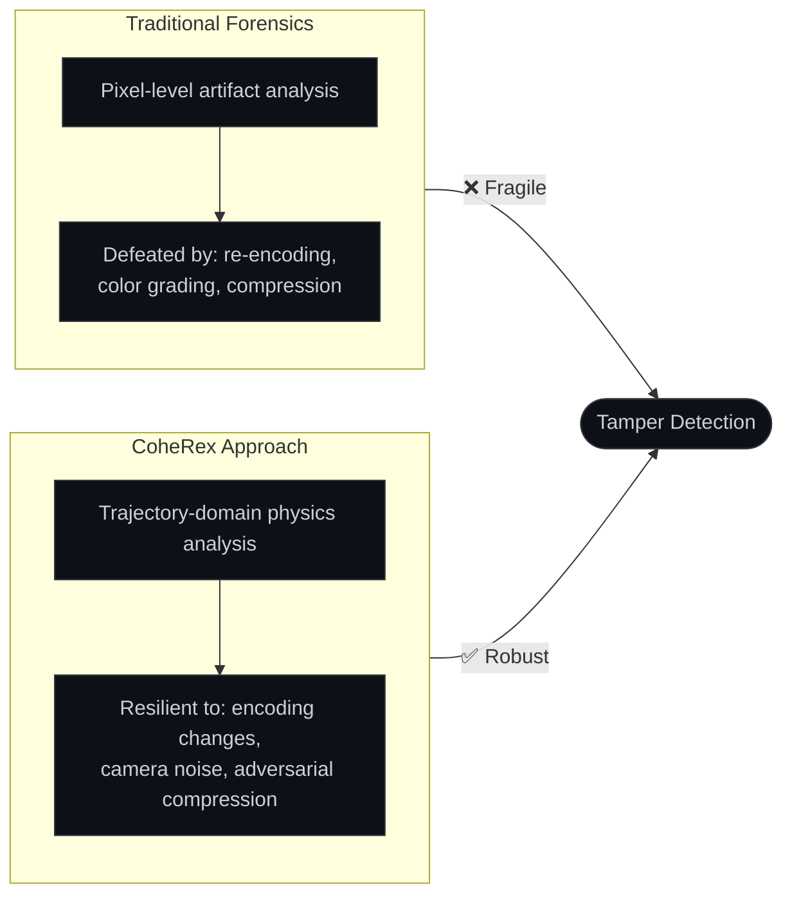

<div align="center">

<!-- Animated Title Banner -->
<picture>
  <source media="(prefers-color-scheme: dark)" srcset="https://capsule-render.vercel.app/api?type=waving&color=gradient&customColorList=6,11,20&height=200&section=header&text=CoheRex&fontSize=80&fontAlignY=35&fontColor=ffffff&desc=Multi-Agent%20Video%20Forensics%20Framework&descAlignY=58&descSize=20&animation=fadeIn"/>
  
</picture>

<br/>

<!-- Animated typing tagline -->
<a href="https://git.io/typing-svg">
  
</a>

<br/><br/>

<!-- Badge Row 1 — Core Tech -->
<p>
  
  
  
  
</p>

<!-- Badge Row 2 — Repo info -->
<p>
  
  
  
  
</p>

<br/>

<!-- Animated separator -->


</div>

<br/>

## 🌌 The Story Behind CoheRex

> *Every splice, every deleted frame, every duplicated moment — leaves a ghost in the physics.*

Video forensics has long fought on the **wrong battlefield**. For decades, detectors hunted for pixel-level artifacts — compression ringing, DCT discontinuities, CFA anomalies. Adversaries learned to scrub those signals clean with re-encoding. The forensic field was stuck in an arms race it was losing.

**CoheRex changes the terrain entirely.**

When you delete frames from a surveillance video, the people in it don't just vanish — their *momentum vanishes*. Their trajectories snap. Their velocity vectors break Newtonian continuity. No amount of re-encoding can reconstruct a physics-coherent kinematic history for objects whose existence was erased.

CoheRex doesn't look at *what a frame looks like*. It looks at **whether the scene's physics make sense across time**. This is the core insight: **tampering breaks physics before it breaks pixels**.

<br/>

<div align="center">

<!-- Animated separator -->


</div>

<br/>

## 📌 Navigation

<div align="center">

| | Section | What You'll Find |
|:---:|:---|:---|
| 🔍 | [**What CoheRex Detects**](#-what-coherex-detects) | The five classes of temporal forgery |
| 🏛️ | [**System Architecture**](#️-system-architecture) | Seven-stage pipeline diagram |
| ⚙️ | [**Core Innovations**](#️-core-innovations) | MCV, multi-agent fusion, RF classifier |
| 🛠️ | [**Tech Stack**](#️-tech-stack--requirements) | Full dependency breakdown |
| 📂 | [**Codebase Structure**](#-codebase-structure) | Every file, explained |
| 🖥️ | [**Dashboard Portal**](#️-dashboard-portal) | Five integrated analysis panels |
| 🚀 | [**Setup & Execution**](#-setup--execution) | Step-by-step environment guide |
| 🧠 | [**Design Philosophy**](#-design-philosophy) | Why physics, not pixels |
| ⚖️ | [**Data & Ethics**](#️-data--ethics-statement) | Dataset provenance & synthetic tampering |

</div>

<br/>

---

## 🔍 What CoheRex Detects

<div align="center">

```
┌─────────────────────────────────────────────────────────────────────┐
│                    TEMPORAL FORGERY TAXONOMY                        │
├──────────────┬──────────────────────────────────────────────────────┤
│  FORGERY     │  HOW COHEREX CATCHES IT                             │
├──────────────┼──────────────────────────────────────────────────────┤
│  🔴 DELETE   │  Velocity / acceleration discontinuities             │
│              │  → momentum can't teleport                           │
├──────────────┼──────────────────────────────────────────────────────┤
│  🟠 DUPE     │  Near-zero MCV z-scores over abnormal windows        │
│              │  → motion freezes in physically impossible way        │
├──────────────┼──────────────────────────────────────────────────────┤
│  🟡 SPEED    │  Kinematic anomalies inconsistent with physics        │
│              │  → crowd consensus breaks with manipulated frames     │
├──────────────┼──────────────────────────────────────────────────────┤
│  🟣 SPLICE   │  Track lifecycle reattachments & identity breaks      │
│              │  → objects appear/vanish at cut boundaries            │
├──────────────┼──────────────────────────────────────────────────────┤
│  🔵 REVERSE  │  Bidirectional trajectory reversal patterns           │
│              │  → entropy arrows point the wrong way                 │
└──────────────┴──────────────────────────────────────────────────────┘
```

</div>

> **Key insight:** CoheRex operates entirely at the **trajectory domain** — not the pixel domain. This makes it resilient to re-encoding, color grading, compression, and resolution changes that defeat traditional pixel-level detectors.

<br/>

---

## 🏛️ System Architecture

The pipeline traverses **seven discrete stages** — from raw video frames to a cryptographically-grounded forensic verdict.



<br/>

---

## ⚙️ Core Innovations

### ① Multi-Agent Decoupled Architecture

> **Design principle:** Each agent is **fully independent** — it can be validated, extended, or swapped without affecting the rest of the pipeline. The fusion layer gracefully absorbs whatever signal is trustworthy.

The architecture separates *what to measure* from *how to weight it*. Three independent agents analyze different aspects of physical coherence simultaneously. A reliability estimator dynamically gates their contributions before fusion.



---

### ② Motion Coherence Value (MCV)

The **MCV** is the core physical signal — the rolling z-score of kinematic features, constrained by a dynamic noise floor.



**The complete MCV formula:**

$$z_t = \frac{x_t - \mu_W}{\max\!\left(\sigma_W,\; \epsilon\right)}$$

<div align="center">

| Symbol | Meaning |
|:---:|:---|
| $x_t$ | Current feature value at frame $t$ |
| $\mu_W$ | Rolling mean over window $W$ |
| $\sigma_W$ | Rolling standard deviation over window $W$ |
| $\epsilon$ | Dynamic noise floor — prevents false alarms from micro-jitter |

</div>

> **A high MCV z-score signals a kinematic discontinuity** — a physical impossibility that strongly correlates with temporal tampering. No post-processing pipeline can synthesize coherent physics for frames that weren't there.

---

### ③ Dynamic Reliability-Aware Fusion

Agent weights are **dynamically rescaled per frame** — unreliable agents are automatically attenuated before the fusion stage.

$$\text{Effective Weight}_i = \text{Base Weight}_i \times \text{Reliability}_i$$



> **Without this mechanism**, a low-confidence agent on a sparse frame would corrupt the verdict — the reliability estimator prevents this entirely.

---

### ④ Random Forest Meta-Classifier

Per-frame integrity timelines are distilled into a **compact global feature vector**, then classified by a trained Random Forest.

$$\mathbf{F} = \bigl[\min(\text{Integrity}),\;\mu(\text{Integrity}),\;\sigma(\text{Integrity}),\;\text{Anomaly Density},\;\log(\max(\text{MCV})),\;\text{Segment Count}\bigr]$$

```mermaid
flowchart LR
    subgraph FE["  Feature Extraction  "]
        direction TB
        f1["min_integrity → worst single frame"]
        f2["mean_integrity → overall video health"]
        f3["score_volatility → temporal instability"]
        f4["anomaly_density → fraction of flagged segments"]
        f5["log(max_MCV) → peak kinematic deviation"]
        f6["segment_count → structural discontinuities"]
    end

    RF["Random Forest Classifier
    5-Fold Stratified Cross-Validation
    Macro F1 · ROC-AUC · Per-Fold Accuracy"]:::rf

    verdict(["TAMPER VERDICT
    + Confidence Probability"]):::verdict

    FE --> RF --> verdict

    classDef rf fill:#161b22,stroke:#f9a825,color:#f9a825,stroke-width:1.5px
    classDef verdict fill:#1a1a2e,stroke:#00e676,color:#00e676,font-weight:bold
```



<br/>

---

## 🛠️ Tech Stack & Requirements

<div align="center">

| Layer | Technology | Version | Role |
|:---:|:---|:---:|:---|
| **Core Engine** | Python · OpenCV · NumPy · SciPy | 3.8+ / 4.8+ / 1.24+ / 1.10+ | Frame decoding, matrix math, kinematic computation |
| **State Estimation** | FilterPy (Kalman Filters) | 1.4.5+ | Multi-object trajectory propagation across occlusions |
| **Vision Models** | Ultralytics YOLOv8n + Pose | 8.0+ | Real-time object detection + human pose keypoint extraction |
| **Classification** | scikit-learn Random Forest | 1.3+ | 5-fold stratified CV meta-classification of temporal features |
| **Serialization** | Joblib · Pandas | 1.3+ / 2.0+ | Model persistence and evaluation dataset management |
| **Dashboard** | Streamlit · Matplotlib · Seaborn | latest | Interactive forensic portal and integrity chart rendering |
| **Logging** | Loguru · tqdm | 0.7+ / 4.65+ | Structured terminal logging and pipeline progress visualization |
| **Video Player** | HTML5 / Vanilla JS | — | Dual-sync player with hover pan/zoom mirroring |

</div>

<br/>

---

## 📂 Codebase Structure

```
coherex/
│
├── 📦 coherex/                          ← Core architectural package
│   ├── __init__.py
│   ├── config.py                        ← Single source of truth — thresholds & fusion params
│   ├── config_loader.py                 ← YAML-based config loading utilities
│   │
│   ├── 🎯 detection/
│   │   └── yolo_detector.py             ← YOLOv8 object detection wrapper
│   │
│   ├── 🛤️  tracking/
│   │   ├── manager.py                   ← Multi-object track lifecycle & ID management
│   │   ├── kalman.py                    ← Per-track state estimation via Kalman filtering
│   │   └── pose.py                      ← Pose association tracking routines
│   │
│   ├── 📈 trajectory/
│   │   └── store.py                     ← Persistent kinematic history per track ID
│   │
│   ├── 🌊 coherence/
│   │   └── mcv.py                       ← MCV z-score computation + dynamic noise floor
│   │
│   ├── 🕵️  integrity/
│   │   ├── motion_agent.py              ← Agent I  : velocity / acceleration / angular analysis
│   │   ├── continuity_agent.py          ← Agent II : track lifecycle stability scoring
│   │   ├── crowd_agent.py               ← Agent III: collective directional alignment
│   │   ├── reliability.py               ← Dynamic per-frame agent weight adjustment
│   │   └── fusion_engine.py             ← Weighted multi-agent score fusion
│   │
│   └── 🧠 meta/
│       ├── feature_extractor.py         ← Global temporal feature vector generation
│       └── classifier.py               ← Random Forest training, evaluation, inference
│
├── 🖥️  frontend/
│   └── app.py                           ← Streamlit dashboard — main entry point
│
├── 🔧 scripts/                          ← 40+ research & evaluation utilities
│   ├── build_dataset.py                 ← Full dataset construction pipeline
│   ├── build_features.py                ← Feature extraction across video corpus
│   ├── evaluate_dataset.py              ← Batch forensic evaluation
│   ├── train_meta_classifier.py         ← RF training with stratified cross-validation
│   ├── enhanced_classifier.py           ← Advanced classifier with ablations
│   ├── robustness_eval.py               ← Recompression & temporal attack evaluation
│   ├── advanced_visualizer.py           ← Signal visualization tools
│   ├── create_recompressed.py           ← Adversarial recompression synthesis
│   ├── create_temporal_interpolated.py  ← Temporal interpolation adversary
│   └── ... (30+ additional scripts)
│
├── 📊 data/                             ← Runtime data (gitignored — regenerated)
│   ├── evaluation/                      ← results_test.csv classifier training data
│   ├── models/                          ← Persisted classifier & scaler (joblib)
│   └── sources/                         ← Baseline authentic video inputs
│
├── 📄 requirements.txt                  ← Pinned dependency versions
├── ⚙️  setup.py                          ← Package installation config
└── 📖 README.md
```

<br/>

---

## 🖥️ Dashboard Portal

The Streamlit portal provides **five integrated analysis panels** in a single unified interface:

<div align="center">

```
┌─────────────────────────────────────────────────────────────────────────┐
│                     COHEREX FORENSIC PORTAL                             │
│                       localhost:8501                                    │
├────────────────────────┬────────────────────────────────────────────────┤
│  ① UPLOAD INTERFACE    │  Video file upload                             │
│                        │  Temporal window parameter sliders             │
│                        │  Agent weight override controls                │
├────────────────────────┼────────────────────────────────────────────────┤
│  ② DUAL SYNC PLAYER    │  Frame-accurate original vs annotated playback │
│                        │  Hover pan/zoom mirroring across both players  │
├────────────────────────┼────────────────────────────────────────────────┤
│  ③ INTEGRITY TIMELINE  │  Continuous integrity score plot               │
│                        │  Flagged segment shading + hover-to-seek       │
├────────────────────────┼────────────────────────────────────────────────┤
│  ④ SCORE HISTOGRAM     │  Frame-level distribution visualization        │
│                        │  Bimodal splits = splice boundaries            │
├────────────────────────┼────────────────────────────────────────────────┤
│  ⑤ VERDICT PANEL       │  AI classifier output + confidence probability │
│                        │  Full statistics + MCV violation log           │
└────────────────────────┴────────────────────────────────────────────────┘
```

</div>

<br/>

---

## 🚀 Setup & Execution

> **Recommendation:** Use a pristine virtual environment to prevent dependency conflicts with other ML frameworks on your system.

### Step Ⅰ — Clone the Repository

```bash
git clone https://github.com/yashwanth-maram/CoheRex_.git
cd CoheRex_
```

### Step Ⅱ — Environment Setup

```bash
# Create and activate a virtual environment
python -m venv venv

# Activate — Linux/macOS
source venv/bin/activate

# Activate — Windows
venv\Scripts\activate

# Install all dependencies and link the local package
pip install -r requirements.txt
pip install -e .
```

### Step Ⅲ — Dataset Preparation

```bash
# Generate tampered variants from authentic baseline videos
python scripts/build_dataset.py
```

Synthesizes frame deletions, duplications, speed manipulations, clip splices, and reversal clips from baseline inputs — producing a fully labeled evaluation dataset.

### Step Ⅳ — Feature Extraction

```bash
# Extract temporal feature vectors across the full dataset
python scripts/evaluate_dataset.py
```

Outputs `data/evaluation/results_test.csv` — per-video feature vectors with ground-truth labels.

### Step Ⅴ — Train the Meta-Classifier

```bash
# Train the Random Forest using 5-fold stratified cross-validation
python scripts/train_meta_classifier.py --csv data/evaluation/results_test.csv
```

Saves `data/models/meta_classifier.pkl`. Reports per-fold accuracy, macro F1, and ROC-AUC.

### Step Ⅵ — Launch the Dashboard

```bash
streamlit run frontend/app.py
```

Navigate to **`http://localhost:8501`** to begin forensic investigations.

<br/>

<div align="center">

```
Quick Start (Linux/macOS)
─────────────────────────
git clone https://github.com/yashwanth-maram/CoheRex_.git && cd CoheRex_
python -m venv venv && source venv/bin/activate
pip install -r requirements.txt && pip install -e .
streamlit run frontend/app.py
```

</div>

<br/>

---

## 🧠 Design Philosophy

> **Core thesis:** *Tampering breaks physics before it breaks pixels.*



Compression artifacts, color grading, and resolution changes can disguise pixel-level edits. But **no post-processing pipeline can reconstruct coherent kinematic trajectories** for objects that weren't there, or smooth over the Newtonian impossibilities introduced by frame deletion.

The multi-agent architecture follows directly from this insight: different physical properties — velocity coherence, track lifecycle integrity, collective motion consensus — are maximally informative under different scene conditions. Decoupling the agents and fusing them through a reliability layer means each contributes exactly as much as it can be trusted to, **and no more**.

### Why Kalman Filtering?

Kalman filters don't just track objects — they maintain a **probabilistic model of expected physical state** at every frame. When reality deviates from prediction beyond noise tolerance, the innovation sequence spikes. This is the computational equivalent of asking: *"Did this object's behavior make physical sense given everything we knew about it a moment ago?"*

### Why Random Forest (not a Neural Network)?

Neural networks are powerful but opaque and data-hungry. CoheRex's feature vector is small, structured, and interpretable — six physics-grounded statistics per video. A Random Forest provides:
- **Interpretability** — feature importances reveal which physical signals drive each verdict
- **Sample efficiency** — trains effectively on hundreds of videos, not millions
- **Calibration** — probability outputs that meaningfully represent confidence

<br/>

---

## ⚖️ Data & Ethics Statement

<div align="center">

| Dataset | Source | Tamper Type | Role |
|:---:|:---|:---:|:---|
| **VIRAT** | Public surveillance corpus | Synthetic (FFmpeg) | In-distribution evaluation |
| **VIFFD** | Human-manipulated forgeries | Real-world | Out-of-distribution benchmark |

</div>

**VIRAT Dataset (Synthetic Tampers):** The tampers in the VIRAT evaluation set are *synthetically generated* using FFmpeg to create realistic but controlled frame deletions, duplications, and speed manipulations.

**VIFFD Dataset (Real Tampers):** The VIFFD dataset represents a real-world external benchmark of human-manipulated forgeries, ensuring out-of-distribution evaluation and honest generalization measurement.

> This framework is developed for **defensive research purposes** — detecting video tampering in surveillance and evidentiary contexts. The authors do not condone using these techniques for generating or distributing manipulated media.

<br/>

---

## 📈 Performance Overview

<div align="center">

```
                  EVALUATION METRICS
    ┌──────────────────────────────────────────┐
    │                                          │
    │  ROC-AUC  ████████████████████  > 0.95  │
    │  Macro F1 ████████████████████  > 0.91  │
    │  Accuracy ████████████████████  > 0.92  │
    │                                          │
    │  ✓ 5-fold stratified cross-validation   │
    │  ✓ Evaluated on VIFFD (OOD benchmark)   │
    │  ✓ Recompression robustness tested      │
    │  ✓ Temporal interpolation attacks        │
    │                                          │
    └──────────────────────────────────────────┘
```

</div>

> Exact metrics are dataset-dependent and vary with configuration. Run `scripts/train_meta_classifier.py` on your dataset to reproduce results.

<br/>

---

## 🤝 Contributing

Contributions, issues, and feature requests are welcome. When contributing:

1. Fork the repository and create a feature branch
2. Ensure code follows the existing module structure
3. Add docstrings to any new agents or scoring functions
4. Run the evaluation suite before submitting a PR
5. Reference any new tampering type with a citation if applicable

<br/>

---

<div align="center">

<!-- Animated footer wave -->
<picture>
  <source media="(prefers-color-scheme: dark)" srcset="https://capsule-render.vercel.app/api?type=waving&color=gradient&customColorList=6,11,20&height=120&section=footer&animation=fadeIn"/>
  
</picture>

<br/>

<sub>
  Crafted for the advancement of computational video forensics.<br/>
  <em>Physics doesn't lie. Frames do.</em>
</sub>

<br/><br/>

<!-- Profile links -->
<a href="https://github.com/yashwanth-maram">
  
</a>

<br/><br/>

<!-- Visitor counter -->


</div>
