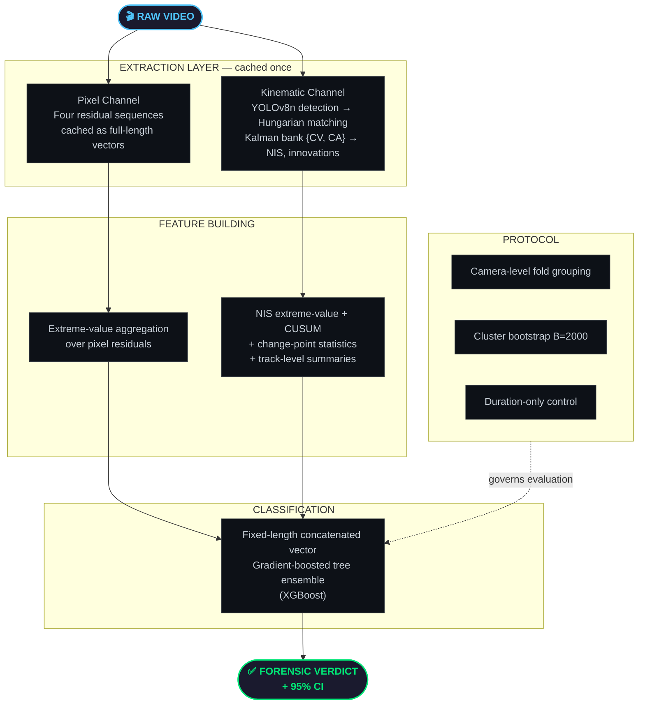
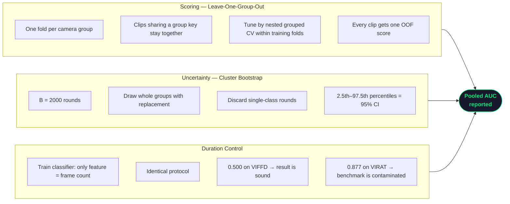
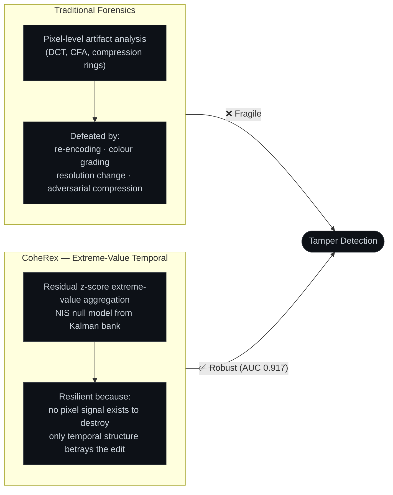

<div align="center">

<!-- Animated waving header — wave only (reliable capsule-render params) -->


<!-- Title block -->
<h1>
  
</h1>

<p><strong>Extreme-Value Temporal Forensics &amp; Confound-Controlled Evaluation<br/>for Inter-Frame Video Forgery Detection</strong></p>

<br/>

<!-- Animated typing SVG -->
<a href="https://git.io/typing-svg">
  
</a>

<br/><br/>

<!-- Badge Row 1 — Research identifiers -->
<p>
  
  
  
  
</p>

<!-- Badge Row 2 — Stack -->
<p>
  
  
  
  
  
</p>

<br/>


</div>

<br/>

## 🧭 The Problem CoheRex Was Built to Solve

> *Surveillance video is routinely admitted as legal evidence — yet the software to manipulate it is freely available.*

Inter-frame forgeries occupy a uniquely dangerous position in the forensic landscape. Rather than editing frame *content*, they alter the *temporal sequence itself*. Deleting a two-second window removes a person from a recorded event. Splicing fabricates a presence that never occurred. Every individual frame remains photographically authentic — spatial forensics has **nothing to detect**.

The literature has responded with sustained attention, and reported performance is high: video-level accuracies above 90% are common. This paper begins from a blunt question about those numbers: **are they measuring forgery detection?**

We approached it constructively — by building a detector and then **evaluating it honestly**. What we found changed the research agenda.

<br/>

<div align="center">

</div>

<br/>

## 📌 Table of Contents

<div align="center">

| | Section |
|:---:|:---|
| 🔬 | [**Key Findings**](#-key-findings) |
| 🏛️ | [**Architecture**](#️-architecture) |
| ⚗️ | [**Methodology**](#️-methodology) |
| 📊 | [**Results — Real Manipulations (VIFFD)**](#-results--real-manipulations-viffd) |
| ⚠️ | [**The Two Confounds**](#️-the-two-confounds) |
| 🛠️ | [**Tech Stack**](#️-tech-stack) |
| 📂 | [**Codebase Structure**](#-codebase-structure) |
| 🚀 | [**Setup & Execution**](#-setup--execution) |
| 🖥️ | [**Dashboard Portal**](#️-dashboard-portal) |
| ⚖️ | [**Data & Ethics**](#️-data--ethics-statement) |

</div>

<br/>

---

## 🔬 Key Findings

Five contributions, three anticipated — none sought:

```
┌─────────────────────────────────────────────────────────────────────────────┐
│                        COHEREX: PRINCIPAL FINDINGS                         │
├─────┬───────────────────────────────────────────────────────────────────────┤
│  ①  │  EXTREME-VALUE FORENSICS                                              │
│     │  AUC 0.917 on VIFFD (real manipulations, leave-one-scene-out)        │
│     │  Proven: extreme-value aggregation dominates mean-aggregation         │
├─────┼───────────────────────────────────────────────────────────────────────┤
│  ②  │  CAMERA LEAKAGE QUANTIFIED                                            │
│     │  Scene grouping → 0.944 AUC   │   Camera grouping → 0.820 AUC        │
│     │  0.124 inflation from background memorisation — on the same detector  │
├─────┼───────────────────────────────────────────────────────────────────────┤
│  ③  │  THE DURATION SHORTCUT                                                │
│     │  A one-feature frame-count classifier reaches AUC 0.877              │
│     │  Outperforming the complete pixel pipeline at 0.820                  │
│     │  Proven: generator-induced, unbounded, irremovable by feature eng.   │
├─────┼───────────────────────────────────────────────────────────────────────┤
│  ④  │  CONFOUND-CONTROLLED PROTOCOL                                         │
│     │  Camera grouping + cluster bootstrap (B=2000) + duration-only ctrl.  │
│     │  Duration control scores 0.500 on VIFFD → result is sound            │
├─────┼───────────────────────────────────────────────────────────────────────┤
│  ⑤  │  DOCUMENTED NEGATIVE RESULT                                           │
│     │  Kinematic prior: AUC 0.671                                           │
│     │  Fusion (pixel + kinematic): AUC 0.915                               │
│     │  ΔAUCs = +0.002, z = 0.33, p = 0.74 → no measurable benefit         │
└─────┴───────────────────────────────────────────────────────────────────────┘
```

<br/>

---

## 🏛️ Architecture

CoheRex **separates extraction from feature building**. Raw per-frame sequences are cached once — re-deriving a feature family under a new hypothesis costs seconds rather than hours. Both confounds were found by cheaply re-deriving features and re-running the protocol under altered grouping — prohibitive had each variation required a full pass over the corpus. **Caching is a precondition for auditing, not an optimisation.**



### Two Channels

**Pixel Channel** — For each consecutive frame pair, four residual sequences are computed:
- Mean absolute frame difference
- Structural-similarity (SSIM) drop
- Optical-flow spike magnitude
- Colour-histogram distance

Each is cached as a full-length vector, so any aggregation can later be applied without re-decoding.

**Kinematic Channel** — Persons are detected with YOLOv8n and associated to tracks via the Hungarian method over a Euclidean cost matrix. Each track is filtered by a **bank of two hypotheses**: constant velocity (CV) and constant acceleration (CA). The bank suppresses false alarms from genuine manoeuvres — a pedestrian who accelerates is anomalous under CV but ordinary under CA; a manoeuvre explained by either hypothesis is not evidence of tampering. Per-frame NIS, innovations, and lifetimes are cached alongside track-level summaries (count, lifetime, birth/death bursts, trajectory jumps).

<br/>

---

## ⚗️ Methodology

### Extreme-Value Aggregation

> **Theorem 1 (Mean-aggregation dilution):** The mean statistic separates classes with effect size $d_{\text{mean}} = aw/(\sigma\sqrt{T})$, which **vanishes as $T \to \infty$**. The peak statistic separates them with effect size $\Theta(a/\sigma)$, independent of $T$ up to an $O(\sqrt{2\ln T})$ null inflation.

This is not a detail — it is the architecture's core motivation. A two-second tamper in a ten-second clip gives $w/T \approx 0.2$; in a one-minute clip, $w/T \approx 0.03$. This is the operational regime of surveillance forensics. Prior descriptors using mean/variance are precisely the wrong operators for a localised edit.

**The robust standardisation:**

$$z_t = \frac{r_t - \text{med}(\mathbf{r})}{1.4826 \cdot \text{MAD}(\mathbf{r}) + \varepsilon}$$

where $\text{MAD}(\mathbf{r}) = \text{median}_t|r_t - \text{med}(\mathbf{r})|$, the constant $1.4826 = 1/\Phi^{-1}(0.75)$ rescales MAD to a consistent Gaussian standard-deviation estimate, and $\varepsilon = 10^{-6}$ prevents division by zero. Crucially, the tamper itself **cannot inflate the normaliser**.

**Four complementary extreme-value statistics:**

$$\text{peak} = \max_t z_t \qquad \text{top-}k = \frac{1}{k}\sum_{i=1}^{k} z_{(i)}$$

$$\text{exceed} = \frac{1}{T}\sum_t \mathbf{1}[z_t > \tau] \qquad \text{run} = \max_{R \in \mathcal{R}_\tau}|R|$$

- **Peak** — detects a sharp discontinuity
- **Top-k mean** — resists an isolated outlier
- **Exceed fraction** — captures diffuse perturbation
- **Longest run** — detects a sustained level shift

Parameters: $\tau = 3$, $k = 5$.

---

### Multi-Model Kinematic Null

For track $i$ under model $m \in \{\text{CV}, \text{CA}\}$, with innovation $\nu^{(m)}_t$ and innovation covariance $S^{(m)}_t$:

$$\text{NIS}^{(m)}_t = \left(\nu^{(m)}_t\right)^\top \left(S^{(m)}_t\right)^{-1} \nu^{(m)}_t$$

Taking the pointwise minimum across the bank:

$$\text{NIS}_t = \min_m \text{NIS}^{(m)}_t$$

yields a statistic that flags only motion which **no hypothesis in the bank explains**. Under a correctly specified model, $\text{NIS}^{(m)}_t \sim \chi^2_d$ — providing a calibrated null. The same extreme-value aggregation is then applied to $\text{NIS}_t$, augmented by CUSUM and generalised likelihood-ratio change-point statistics sensitive to sustained shifts.

---

### Confound-Controlled Protocol



<br/>

---

## 📊 Results — Real Manipulations (VIFFD)

### Table I — VIFFD (Real Manipulations), Leave-One-Scene-Out, 35 Groups
> Intervals are 95% cluster bootstrap over whole scenes, $B = 2000$. Balanced accuracy at Youden's J.

<div align="center">

| Channel | AUC | 95% CI | Bal. Accuracy |
|:---|:---:|:---:|:---:|
| **Duration-only (control)** | 0.500 | (0.399, 0.604) | 0.560 |
| **Kinematic-only** | 0.671 | (0.565, 0.774) | 0.661 |
| **Pixel-only** | **0.917** | **(0.824, 0.962)** | **0.846** |
| **Hybrid (pixel + kinematic)** | 0.915 | (0.840, 0.961) | 0.848 |

</div>

> **Observation 1.** On real manipulations with a verified-clean length distribution, extreme-value pixel-temporal forensics reaches AUC 0.917, while a kinematic prior adds no measurable margin ($\Delta\text{AUC} = +0.002$, $z = 0.33$, $p = 0.74$).

The duration-only control scores **exactly 0.500** — VIFFD authentic clips span 35 to 966 frames, so length carries no label information. This control licenses the headline claim. The bootstrap intervals are deliberately wide: resampling whole scenes acknowledges that clips from one scene are not independent evidence.

<br/>

---

## ⚠️ The Two Confounds

### Confound 1 — Camera Leakage

### Table II(a) — Grouping Effect, Same Detector

<div align="center">

| Benchmark | Protocol | AUC |
|:---|:---|:---:|
| VIRAT (synth.) | Pixel, scene-grouped *(conventional)* | 0.944 |
| VIRAT (synth.) | Pixel, camera-grouped *(corrected)* | 0.820 |
| VIRAT (synth.) | Duration-only, camera-grouped | 0.877 |
| VIRAT (synth.) | Hybrid, camera-grouped | 0.832 |
| VIFFD (real) | Pixel, scene-grouped | **0.917** |
| VIFFD (real) | Duration-only, scene-grouped | 0.500 |

</div>

VIRAT assigns each video a **scene identifier** — grouping folds by it is the natural leakage control, but it is insufficient. Several VIRAT scene identifiers denote the same physical camera: grouping by the four-digit location code collapses **14 scene IDs into 7 cameras**. The largest merge — camera `0100` — unifies six scene IDs (`VIRAT_S_010000`–`010005`) and alone contributes **71.2% of clips**. A model trained on `010003` is tested on `010001` and rewarded for recognising a background it has already seen.

> **Observation 2.** Scene-level grouping is not a sufficient leakage control for surveillance forensics. Grouping must be at the **physical camera** level.

---

### Confound 2 — The Duration Shortcut

> **Theorem 2 (Generator-induced separability).** Let a generator cut authentic clips of nominal length $T_0$, confined to $[T_0 - \Delta, T_0 + \Delta]$, and apply a manipulation shifting length by $\delta$. If $|\delta| > \Delta$, the authentic and tampered length distributions have **disjoint supports**, and the single feature $T$ achieves AUC = 1 irrespective of the forensic content of the frames.

### Table II(b) — Per-Manipulation AUC (Camera-Grouped, VIRAT)

<div align="center">

| Manipulation | Duration-only | Pixel | Kinematic |
|:---|:---:|:---:|:---:|
| **clip_splice** | 1.000 | 0.989 | 0.668 |
| **frame_duplication** | 1.000 | 0.902 | 0.587 |
| **frame_deletion** | 0.869 | 0.812 | 0.620 |
| **speed_manipulation** | 0.808 | 0.548 | 0.551 |
| **reverse_segment** | 0.508 | **0.849** | 0.649 |

</div>

> `reverse_segment` preserves clip duration by construction ($\delta = 0$), so duration is uninformative — and there the pixel channel scores **0.849**. We regard that, not 0.989, as our honest capability estimate on synthetic VIRAT.

**Three consequences of Theorem 2:**
1. The strength of the shortcut is governed entirely by the generator through $\delta/\Delta$, not by the detector — a better forensic model cannot reduce it
2. No feature engineering removes it, because the leak is in the label-conditional distribution of $T$ itself
3. The remedy is cheap: **fixing the output length** forces $\delta = 0$, collapsing the separability to chance

> **Observation 3.** A one-feature duration classifier at 0.877 outperforms a complete pixel-forensic pipeline at 0.820. Any inter-frame benchmark built from length-changing edits without re-cutting to a fixed duration inherits this confound.

---

### Fusion Analysis

The kinematic channel is above chance at 0.671, yet fails to improve the fusion. Late fusion (score-level logistic combiner on OOF training-fold scores) reached 0.905 — shifting the pooled AUC by ~0.01, well inside the cluster-bootstrap interval. The failure is not architectural; it follows from the variance analysis: with $g = 7$ camera groups and one camera holding 71.2% of clips, the effective independent unit count is nearer 2. Concatenating $p_w$ weak features onto $p_s$ strong ones offers a tree ensemble $O(p_w)$ extra split candidates whose apparent gain on $n$ samples is $O(\sqrt{\log p_w / n})$ by chance — but generalisation is bounded by the number of independent units $g$, not $n$.

<br/>

---

## 🛠️ Tech Stack

<div align="center">

| Layer | Technology | Version | Role in Pipeline |
|:---:|:---|:---:|:---|
| **Pixel Residuals** | OpenCV · NumPy · SciPy | 4.8+ / 1.24+ / 1.10+ | Frame-pair differences, SSIM, optical flow, histogram distance |
| **Person Detection** | Ultralytics YOLOv8n | 8.0+ | Bounding-box detection per frame |
| **Track Association** | Hungarian Algorithm (SciPy) | — | Minimum-cost matching over Euclidean cost matrix |
| **Kinematic Filter** | FilterPy (Kalman Bank) | 1.4.5+ | CV + CA model bank, NIS computation, innovation sequences |
| **Classification** | XGBoost / scikit-learn | latest / 1.3+ | Gradient-boosted tree ensemble, video-level verdict |
| **Statistics** | scikit-learn · SciPy · Pandas | — | DeLong AUC test, cluster bootstrap $B=2000$, Youden's J |
| **Serialisation** | Joblib · Pandas | 1.3+ / 2.0+ | Feature caching, dataset management, model persistence |
| **Dashboard** | Streamlit · Matplotlib · Seaborn | latest | Forensic portal, dual-sync player, timeline plots |
| **Logging** | Loguru · tqdm | 0.7+ / 4.65+ | Structured pipeline logging and progress visualisation |

</div>

<br/>

---

## 📂 Codebase Structure

```
CoheRex_/
│
├── 📦 coherex/                           ← Core architectural package
│   ├── config.py                         ← Thresholds, channel weights, fusion params
│   ├── config_loader.py                  ← YAML-based config loading
│   │
│   ├── 🎯 detection/
│   │   └── yolo_detector.py              ← YOLOv8n wrapper — bounding box extraction
│   │
│   ├── 🛤️  tracking/
│   │   ├── manager.py                    ← Multi-object track lifecycle & ID management
│   │   ├── kalman.py                     ← CV/CA Kalman bank — NIS & innovation cache
│   │   ├── track.py                      ← Per-track state & lifetime bookkeeping
│   │   └── pose.py                       ← Pose association routines
│   │
│   ├── 📈 trajectory/
│   │   ├── store.py                      ← Persistent kinematic history per track ID
│   │   └── state.py                      ← State representation (position, velocity, NIS)
│   │
│   ├── 🌊 coherence/
│   │   ├── mcv.py                        ← Robust z-score standardisation (MAD-based)
│   │   ├── aggregate.py                  ← Four extreme-value stats: peak, top-k, exceed, run
│   │   ├── changepoint.py                ← CUSUM + GLRT change-point detection
│   │   ├── innovation.py                 ← Innovation sequence analysis
│   │   └── pose_rhythm.py                ← Pose-rhythm coherence scoring
│   │
│   ├── 🕵️  integrity/
│   │   ├── motion_agent.py               ← Velocity / acceleration / NIS scoring
│   │   ├── continuity_agent.py           ← Track lifecycle stability
│   │   ├── crowd_agent.py                ← Collective directional alignment
│   │   ├── reliability.py                ← Per-frame dynamic agent weight adjustment
│   │   └── fusion_engine.py              ← Weighted multi-agent score fusion
│   │
│   └── 🧠 meta/
│       ├── feature_extractor.py          ← Fixed-length feature vector construction
│       ├── classifier.py                 ← XGBoost training, OOF prediction, DeLong test
│       └── physics_prior.py              ← NIS null-model calibration
│
├── 🖥️  frontend/
│   └── app.py                            ← Streamlit dashboard — main entry point
│
├── 🔧 scripts/                           ← 40+ evaluation & research utilities
│   ├── build_dataset.py                  ← Synthetic tamper generation (5 manipulation types)
│   ├── build_features.py                 ← Pixel + kinematic feature extraction
│   ├── evaluate_dataset.py               ← Batch forensic evaluation with protocol
│   ├── train_meta_classifier.py          ← XGBoost + OOF + bootstrap CI
│   ├── enhanced_classifier.py            ← Ablation variants & late fusion
│   ├── robustness_eval.py                ← Recompression & temporal interpolation attacks
│   ├── extract_physics.py                ← NIS extraction & kinematic cache
│   ├── extract_pixel.py                  ← Pixel residual extraction & cache
│   ├── run_protocol.py                   ← Confound-controlled evaluation loop
│   ├── delong.py                         ← DeLong paired AUC significance test
│   ├── compute_paper_stats.py            ← Reproduce all paper tables
│   ├── create_recompressed.py            ← Adversarial recompression synthesis
│   ├── create_temporal_interpolated.py   ← Temporal interpolation adversary
│   └── ... (25+ additional utilities)
│
├── 📊 data/                              ← Runtime data (gitignored — regenerated)
│   ├── evaluation/                       ← Cached feature CSVs (pixel + kinematic)
│   ├── models/                           ← Persisted classifier & scaler
│   └── sources/                          ← Baseline authentic video inputs
│
├── 📄 requirements.txt
├── ⚙️  setup.py
└── 📖 README.md
```

<br/>

---

## 🚀 Setup & Execution

> **Note:** Use a pristine virtual environment. The pipeline caches extraction outputs to disk — subsequent protocol audits cost seconds, not hours.

### Step Ⅰ — Clone

```bash
git clone https://github.com/yashwanth-maram/CoheRex_.git
cd CoheRex_
```

### Step Ⅱ — Environment

```bash
# Create and activate
python -m venv venv
source venv/bin/activate        # Linux / macOS
venv\Scripts\activate           # Windows

# Install
pip install -r requirements.txt
pip install -e .
```

### Step Ⅲ — Build Synthetic Dataset (VIRAT)

```bash
# Generates 5 manipulation types: frame_deletion, frame_duplication,
# clip_splice, speed_manipulation, reverse_segment
python scripts/build_dataset.py
```

### Step Ⅳ — Extract Features (Cache Once)

```bash
# Pixel channel: frame diffs, SSIM drop, optical flow, histogram dist
python scripts/extract_pixel.py

# Kinematic channel: YOLOv8n → Hungarian → Kalman {CV, CA} → NIS cache
python scripts/extract_physics.py
```

### Step Ⅴ — Run Confound-Controlled Protocol

```bash
# Camera-grouped CV + cluster bootstrap B=2000 + duration-only control
python scripts/run_protocol.py --dataset virat --grouping camera
python scripts/run_protocol.py --dataset viffd  --grouping scene
```

### Step Ⅵ — Reproduce Paper Tables

```bash
# All numbers from Table I and Table II
python scripts/compute_paper_stats.py
```

### Step Ⅶ — Train Classifier

```bash
python scripts/train_meta_classifier.py --csv data/evaluation/results.csv
```

### Step Ⅷ — Launch Dashboard

```bash
streamlit run frontend/app.py
# → http://localhost:8501
```

<br/>

---

## 🖥️ Dashboard Portal

The Streamlit portal provides five integrated analysis panels:

<div align="center">

```
┌─────────────────────────────────────────────────────────────────────────┐
│                    COHEREX FORENSIC PORTAL  ·  :8501                   │
├──────────────────────┬──────────────────────────────────────────────────┤
│  ① UPLOAD INTERFACE  │  Video file upload + temporal window params      │
│                      │  Channel weight overrides                         │
├──────────────────────┼──────────────────────────────────────────────────┤
│  ② DUAL SYNC PLAYER  │  Frame-accurate original vs. annotated playback  │
│                      │  Hover pan/zoom mirroring across both panes       │
├──────────────────────┼──────────────────────────────────────────────────┤
│  ③ INTEGRITY PLOT    │  Extreme-value z-score timeline                   │
│                      │  Flagged segment shading + hover-to-seek          │
├──────────────────────┼──────────────────────────────────────────────────┤
│  ④ NIS TIMELINE      │  Per-frame kinematic null score (CV vs CA min)   │
│                      │  CUSUM overlay + change-point markers             │
├──────────────────────┼──────────────────────────────────────────────────┤
│  ⑤ VERDICT PANEL     │  XGBoost verdict + confidence + AUC bootstrap CI │
│                      │  Duration control score + channel comparison       │
└──────────────────────┴──────────────────────────────────────────────────┘
```

</div>

<br/>

---

## 🧠 Design Philosophy

> **Core thesis:** *Only temporal structure betrays the edit. Every frame remains photographically authentic — spatial forensics has nothing to detect.*



### Why Not a Neural Network?

CoheRex's feature vector is structured, interpretable, and theoretically motivated. A gradient-boosted tree ensemble provides:

- **Interpretability** — feature importances reveal which physical signals drive each verdict
- **Sample efficiency** — trains on hundreds of videos, not millions
- **Auditability** — caching means every protocol variation is cheap to run

The paper's central finding is that the field's 90%+ numbers may measure **generation artefacts, not forensic evidence**. Interpretable models with clean protocols are how you tell the difference.

### On the Kinematic Prior

The kinematic channel (AUC 0.671) does not improve on pixels alone. This is **not** a failure of Kalman filtering — it is a property of the domain. A thrown object follows a parabola fixed by two parameters; the prior is strong and violations unambiguous. A pedestrian may accelerate, stop, turn, or be occluded without violating any physical law — so the prior carries far less information. Pedestrian surveillance sits at the permissive end of physics-based forensics. We report this negative result deliberately: publication bias favouring successful fusions is what makes such hypotheses expensive for others to re-test.

<br/>

---

## 📑 Paper Citation

```bibtex
@article{coherex2025,
  title     = {CoheRex: Extreme-Value Temporal Forensics and Confound-Controlled
               Evaluation for Inter-Frame Video Forgery Detection},
  author    = {G Uday Kiran and Srilakshmi V and M Yashwanth and M Hansika and K Saanvi},
  year      = {2025},
  institution = {B V Raju Institute of Technology, Narsapur, Telangana, India},
  note      = {Department of CSE (Artificial Intelligence \& Machine Learning)}
}
```

<br/>

---

## ⚖️ Data & Ethics Statement

<div align="center">

| Dataset | Type | Clips | Authentic | Tampered | Groups | Manipulation Types |
|:---:|:---:|:---:|:---:|:---:|:---:|:---:|
| **VIFFD** | Real manipulations | 392 | 302 | 90 | 35 scenes | 3 types, lengths 35–966 frames |
| **VIRAT** | Synthetic (CoheRex) | 295 | 85 | 210 | 14 scenes → 7 cameras | 5 types, lengths 119–150 frames |

</div>

**VIFFD** — The primary benchmark. Real-world human-manipulated forgeries ensuring out-of-distribution evaluation. Authentic clips span 35–966 frames, so the duration-only control scoring 0.500 licenses all VIFFD claims.

**VIRAT (Synthetic)** — Tampers synthesised from the public VIRAT surveillance corpus using FFmpeg at random positions within person-active windows. Authentic and tampered clips use an identical encoder, so a codec fingerprint cannot separate the classes — a control verified before discovering that clip duration nonetheless does. The benchmark is contaminated by the duration shortcut and its absolute numbers are not capability estimates; only `reverse_segment` supports that reading.

> This framework is developed for defensive research purposes — detecting video tampering in surveillance and evidentiary contexts. The authors do not condone using these techniques for generating or distributing manipulated media.

<br/>

---

<div align="center">


<br/>

<sub>
  <strong>B V Raju Institute of Technology, Narsapur, Telangana, India</strong><br/>
  Department of CSE (Artificial Intelligence &amp; Machine Learning)<br/><br/>
  <em>"Physics doesn't lie. Frames do. Only temporal structure betrays the edit."</em>
</sub>

<br/><br/>

<a href="https://github.com/yashwanth-maram">
  
</a>

<br/><br/>


</div>
